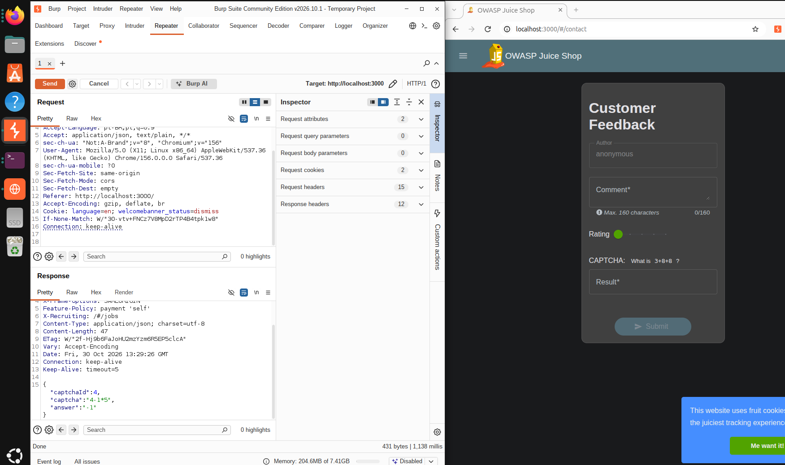
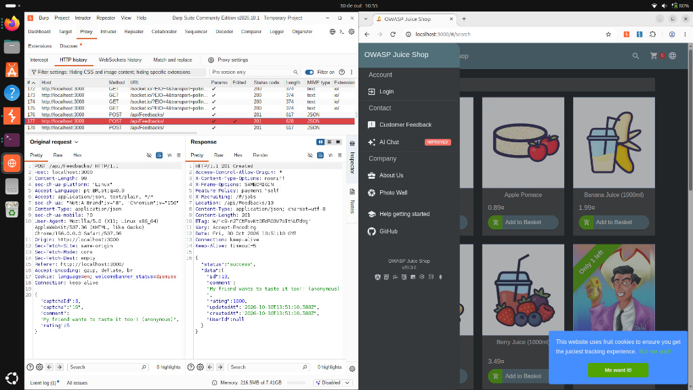
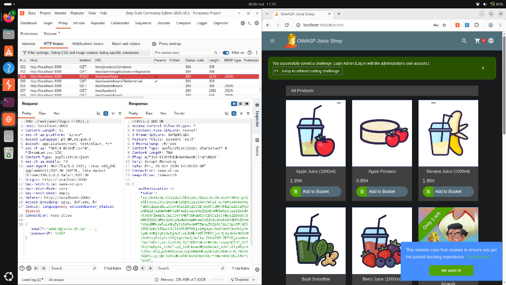

# Relatório de Exploração - Bloco 2 
**Trainee:** Larissa Silva Passos

## 1. Rotas, Arquivos e Endpoints Interessantes

**Descoberta 1: Vazamento de Resposta do CAPTCHA (Information Exposure)**
* **Endpoint / Rota:** `GET /rest/captcha/`
* **Análise da Vulnerabilidade:** Ao utilizar o Burp Suite para analisar a comunicação com o servidor durante a geração de um novo desafio na página de Customer Feedback, nota-se uma falha grave na estrutura da resposta HTTP. O servidor retorna um objeto JSON que contém o identificador do desafio e vaza a solução matemática correta em texto claro no campo `"answer"`.
* **Impacto:** A exposição da resposta no lado do cliente anula totalmente a eficácia do CAPTCHA. Um atacante pode desenvolver um script simples para ler essa resposta no JSON e preencher o formulário automaticamente, permitindo ataques de automação (bots) e envio massivo de requisições maliciosas.

**Descoberta 2: Manipulação de Parâmetros na API de Feedback (Parameter Tampering)**
* **Endpoint / Rota:** `POST /api/Feedbacks/`
* **Análise da Vulnerabilidade:** A interface gráfica da aplicação restringe a avaliação de feedback entre 1 e 5 estrelas. No entanto, ao interceptar a requisição de envio, foi possível modificar o corpo do JSON e injetar o valor `"rating": 1000`. 
* **Impacto:** O backend não realiza a validação de entrada para os limites estabelecidos na regra de negócio. O servidor aceitou o parâmetro adulterado e o processou com sucesso (retornando status `201 Created`), o que compromete a integridade dos dados da aplicação.

**Descoberta 3: Bypass de Autenticação via SQL Injection**
* **Endpoint / Rota:** `POST /rest/user/login` e `GET /rest/user/whoami`
* **Análise da Vulnerabilidade:** Após identificar o e-mail do administrador em um comentário que ele mesmo fez no produto "apple juice", injetei o payload `' --` no campo de e-mail da tela de login. Os caracteres manipularam a consulta SQL no backend, fechando a string do usuário e comentando o restante do código que faria a validação da senha.
* **Impacto:** O servidor autorizou o login e concedeu um token JWT de administrador sem verificar a credencial. A requisição subsequente confirmou a escalação de privilégios para a conta `admin@juice-sh.op`, resultando no comprometimento completo do sistema.

## 2. Detalhes do rastreamento da Conta Administradora

**Método utilizado:**
Para rastrear e identificar o e-mail da conta administradora, realizei uma investigação passiva (OSINT/Reconhecimento) na interface gráfica da loja. Acessei a página principal e abri a janela de detalhes do produto "Apple Juice (1000ml)". Ao inspecionar a seção de avaliações públicas (Reviews), identifiquei que a própria conta de administração publicou um comentário, expondo de forma insegura o seu endereço de e-mail corporativo real (`admin@juice-sh.op`) para qualquer visitante do site.

## 3. Evidências

