# Relatório de Mapeamento, Reconhecimento e Análise de Segurança

**Nome:** Gabriel Pedrozo Ribeiro  
**Projeto:** SACI-UFLA — Trilha Red Team  
**Alvo:** OWASP Juice Shop  
**Ambiente:** Local, executado via Docker  
**Ferramenta principal:** Burp Suite Community Edition  
**Data:** 30/10/2026

---

## 1. Objetivo

O objetivo desta atividade foi realizar o mapeamento e o reconhecimento da superfície de ataque da aplicação OWASP Juice Shop, simulando as etapas iniciais de uma avaliação de segurança ofensiva em um ambiente controlado e autorizado.

A análise não se limitou à navegação pela página inicial. Foram investigadas rotas disponíveis no front-end, arquivos públicos, requisições HTTP e respostas das APIs, buscando identificar informações expostas, funcionalidades não evidentes na interface e possíveis falhas de validação e controle de acesso.

Também foi realizada uma investigação para identificar informações relacionadas à conta administrativa da aplicação.

## 2. Metodologia

Inicialmente, a aplicação OWASP Juice Shop foi executada localmente por meio do Docker e acessada pelo navegador com o Burp Suite configurado para interceptar o tráfego HTTP.

A metodologia foi dividida nas seguintes etapas:

1. **Reconhecimento da aplicação:** navegação pelas funcionalidades disponíveis, observando páginas, produtos, avaliações e demais recursos.
2. **Análise do tráfego HTTP:** utilização do Proxy e do HTTP History do Burp Suite para identificar requisições, endpoints, parâmetros e respostas da aplicação.
3. **Análise client-side:** inspeção do arquivo `main.js`, procurando rotas configuradas no front-end que não estavam evidentes na navegação convencional.
4. **Enumeração de arquivos públicos:** consulta ao `robots.txt` e investigação dos caminhos indicados por ele.
5. **Análise das APIs:** inspeção das respostas JSON e realização de testes controlados com o Repeater para verificar o comportamento dos endpoints diante de parâmetros e atributos modificados.
6. **Registro de evidências:** captura das requisições, respostas e comportamentos observados durante os testes.

Todos os testes foram realizados exclusivamente no ambiente local do OWASP Juice Shop.

**Evidência 01 — Página inicial da aplicação**

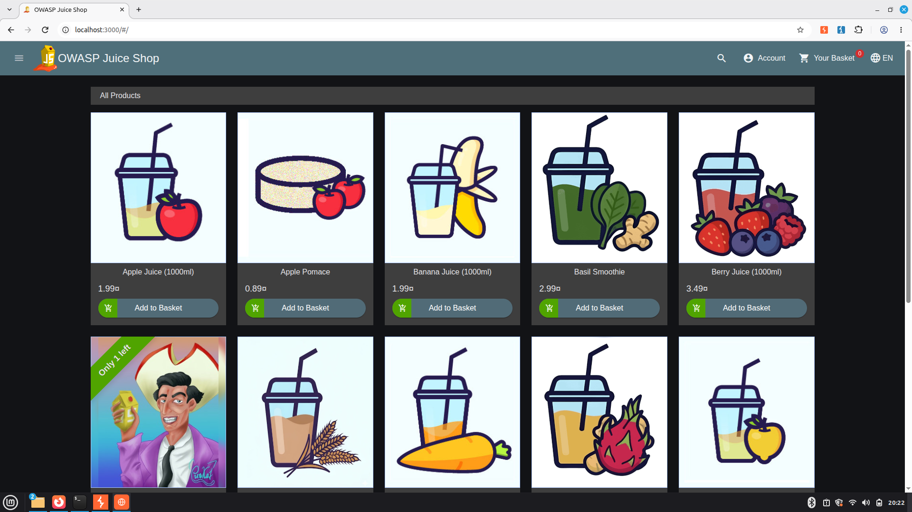

## 3. Mapeamento de rotas e páginas

Durante a análise do arquivo `main.js`, foi realizada uma busca por declarações de caminhos utilizando a palavra-chave `path:`. Esse procedimento permitiu identificar rotas configuradas no front-end, incluindo páginas que não estavam diretamente disponíveis no menu principal.

As seguintes rotas foram identificadas:

| Rota | Descrição | Observação |
|---|---|---|
| `/#/score-board` | Painel de pontuação e desafios | Rota identificada no front-end |
| `/#/administration` | Painel administrativo | Requer investigação dos controles de autorização |
| `/#/privacy-security/privacy-policy` | Página de política de privacidade | Página informativa |

**Evidências:**
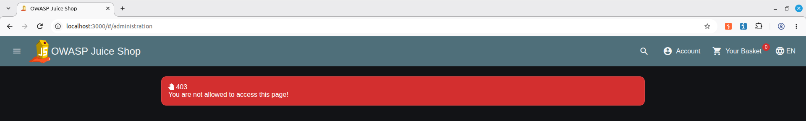

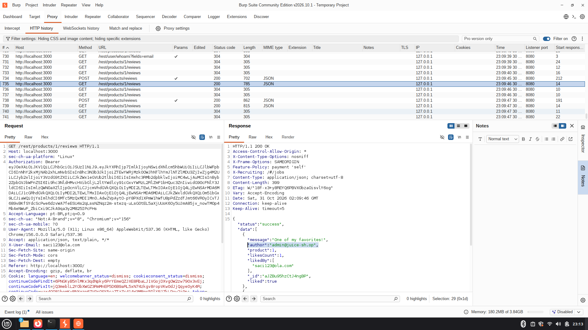

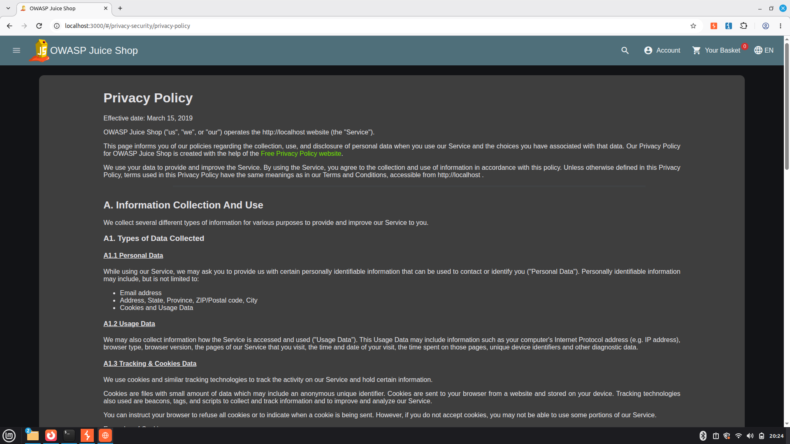

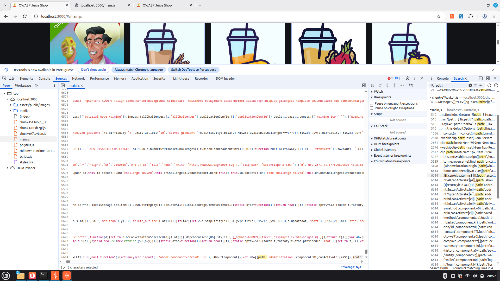

A identificação da rota administrativa demonstra que seu caminho está presente no código disponibilizado ao navegador. Entretanto, a existência e o acesso à rota não comprovam, isoladamente, uma falha de autorização. Para confirmar uma vulnerabilidade seria necessário demonstrar que um usuário sem privilégios consegue executar operações administrativas protegidas.

A descoberta dessas rotas contribui para o mapeamento da superfície de ataque e permite direcionar investigações posteriores.

## 4. Análise de arquivos públicos

### 4.1. Arquivo robots.txt

Foi realizada uma consulta direta ao arquivo:

`http://localhost:3000/robots.txt`

O conteúdo retornado foi:

```text
User-agent: *
Disallow: /ftp
```

A diretiva `User-agent: *` indica que a regra se aplica aos mecanismos de busca e outros crawlers que respeitam o protocolo Robots Exclusion Protocol.

Já a diretiva `Disallow: /ftp` solicita que esses mecanismos não rastreiem o caminho `/ftp`.

Esse arquivo não representa um mecanismo de autenticação ou controle de acesso. Portanto, a indicação de um diretório no `robots.txt` não impede que um usuário acesse diretamente seu endereço.

**Evidência 06 — Conteúdo do robots.txt**

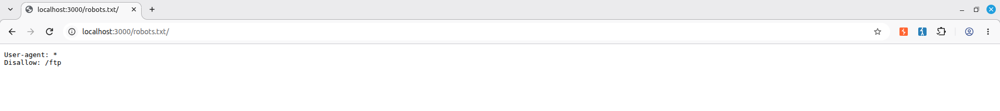

### 4.2. Diretório /ftp

Após identificar o caminho no `robots.txt`, foi realizada uma consulta direta ao endereço:

`http://localhost:3000/ftp/`

A investigação teve como objetivo verificar se o diretório disponibilizava arquivos publicamente e se era possível visualizar ou baixar seu conteúdo sem autenticação.

**Evidência 07 — Diretório FTP**

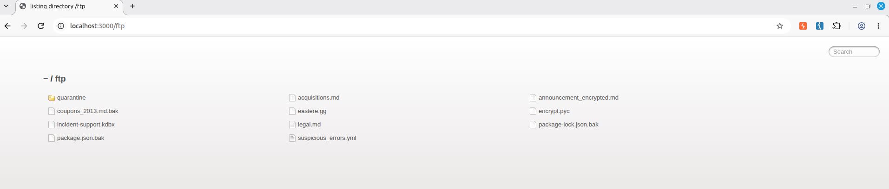

A exposição de arquivos deve ser avaliada considerando seu conteúdo, a necessidade de autenticação e a existência de informações que deveriam permanecer restritas. A simples disponibilidade de uma listagem não permite concluir que houve vazamento de dados sensíveis.

## 5. Análise de endpoints e possíveis vulnerabilidades

Durante a análise do tráfego HTTP, foram identificados endpoints que apresentaram comportamentos relevantes para a segurança da aplicação.

Os testes foram realizados por meio da inspeção das requisições e respostas no Burp Suite, utilizando principalmente o recurso Repeater para comparar o comportamento da API diante de diferentes parâmetros.

### 5.1. API de Feedbacks — possível manipulação da identidade do autor

**Endpoint:** `/api/Feedbacks`

Durante a análise da API de feedbacks, foi investigado o comportamento do campo `UserId`, responsável por identificar o usuário associado a um comentário.

Foi observado que a requisição permite informar manualmente um identificador de usuário. Esse comportamento levanta a possibilidade de que o servidor esteja confiando em um valor fornecido pelo cliente para determinar a identidade do autor do feedback.

Para confirmar a falha, é necessário verificar se o servidor efetivamente aceita o identificador informado e associa o comentário ao usuário indicado, mesmo quando ele não corresponde à identidade autenticada na sessão.

**Possível vulnerabilidade:** falha de autorização ou confiança indevida em identificadores fornecidos pelo cliente.

**Impacto potencial:** associação de comentários à identidade de outros usuários, possibilitando falsificação de autoria e comprometimento da integridade das informações.

**Recomendação:** o servidor deve obter a identidade do usuário autenticado a partir da sessão ou do token de autenticação, sem confiar em identificadores de autoria enviados livremente pelo cliente.

**Evidência 08 — Teste da API de Feedbacks**

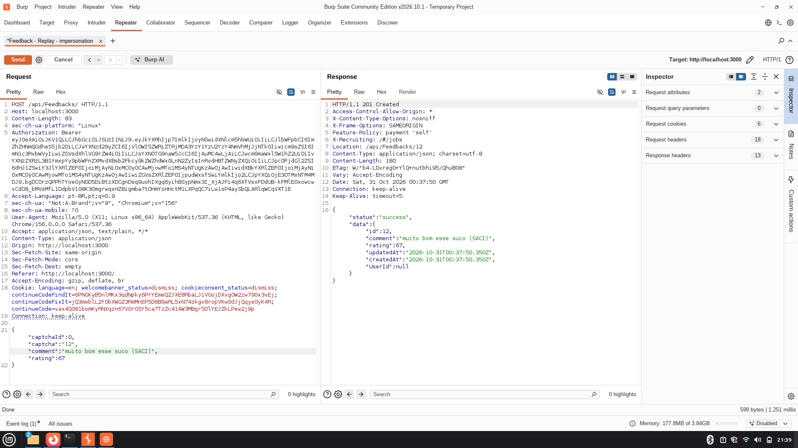


### 5.2. Photo Wall — exposição de informações de usuários

**Endpoint:** `/rest/memories`

Durante a investigação do recurso Photo Wall, foi analisada a resposta da API responsável por disponibilizar as memórias cadastradas pelos usuários.

Foram observados registros contendo informações associadas às publicações, como imagens e legendas.

Esse comportamento merece investigação quanto à natureza das informações disponibilizadas e à existência de controles de acesso adequados.

É importante distinguir informações que foram intencionalmente publicadas para visualização pública de dados pessoais ou privados que deveriam estar protegidos.

**Possível vulnerabilidade:** exposição indevida de informações, caso os registros contenham dados que deveriam estar restritos.

**Impacto potencial:** divulgação de informações pessoais ou conteúdo privado de usuários.

**Recomendação:** revisar os dados retornados pela API, aplicar controles de acesso quando necessários e evitar disponibilizar informações pessoais que não sejam essenciais para a funcionalidade.

**Evidência 09 — Resposta da API de memórias**

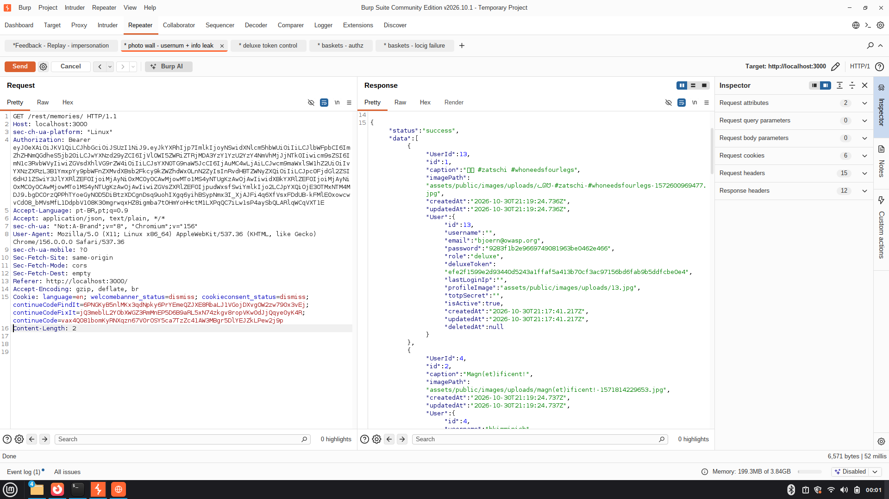

*Observação: a existência de registros públicos não comprova, isoladamente, uma falha de confidencialidade. A classificação depende da identificação de dados efetivamente restritos.*

### 5.3. Cadastro de usuários — controle indevido do campo deluxeToken

**Endpoint:** `POST /api/Users/`

Durante a análise da funcionalidade de cadastro, foi interceptada a requisição responsável pela criação de novos usuários.

Na requisição original, foram enviados os campos de e-mail, senha, confirmação de senha, pergunta de segurança e resposta de segurança. O atributo `deluxeToken` não fazia parte do corpo original.

Mesmo sem receber esse atributo, o servidor retornou o campo `deluxeToken` vazio na resposta do cadastro.

Para investigar o comportamento, foi realizado um segundo teste controlado utilizando o Burp Suite Repeater. Nesse teste, foi acrescentado manualmente o campo `deluxeToken` ao JSON enviado ao servidor, com o valor `"TESTE"`.

A segunda requisição foi processada com sucesso, retornando o status HTTP `201 Created`. Na resposta, o servidor manteve o valor informado pelo cliente:

```json
{
  "status": "success",
  "data": {
    "id": 26,
    "email": "saci-teste2@ola.com",
    "role": "customer",
    "deluxeToken": "TESTE"
  }
}
```

A comparação entre as duas respostas demonstrou que o servidor aceitou e persistiu o atributo adicional enviado manualmente pelo cliente.

Esse comportamento caracteriza um indício reproduzível de **Mass Assignment**, pois um atributo que não fazia parte do fluxo normal de cadastro pôde ser definido diretamente na requisição.

Entretanto, não foi comprovado se a manipulação desse campo concede benefícios Deluxe ou produz algum impacto funcional adicional.

**Impacto potencial:** caso o campo seja utilizado pelo sistema para conceder benefícios ou liberar funcionalidades, sua manipulação poderá permitir acesso indevido a recursos.

**Recomendação:** implementar uma lista de campos permitidos para operações de cadastro, impedindo que atributos sensíveis sejam definidos diretamente pelo cliente. Campos relacionados a privilégios e benefícios devem ser controlados exclusivamente pelo servidor.

**Evidências:**
- evidencias/vulnerabilidade3.png


### 5.4. Carrinhos de compras — possível IDOR

**Endpoint:** `/rest/basket/{id}`

Durante a análise da funcionalidade de carrinho de compras, foi investigado o comportamento do endpoint responsável por retornar os dados de um carrinho específico.

O teste consistiu em observar a requisição e verificar o comportamento da aplicação diante da alteração do identificador presente no caminho da URL.

Foi relatada a possibilidade de visualizar carrinhos associados a outros identificadores.

Esse tipo de falha ocorre quando a aplicação permite acessar um objeto por meio de seu identificador sem verificar adequadamente se o usuário autenticado possui autorização para acessá-lo.

Para confirmar a vulnerabilidade, é necessário demonstrar que o carrinho acessado pertence a outra conta e que o servidor retorna seus dados sem autorização adequada.

**Impacto potencial:** exposição de informações de outros usuários e possível comprometimento da confidencialidade dos dados associados aos carrinhos.

**Recomendação:** validar no servidor a propriedade do recurso em todas as operações realizadas sobre carrinhos, verificando se o usuário autenticado possui autorização para consultar ou modificar aquele objeto.

**Evidência 12 — Teste de acesso ao carrinho**

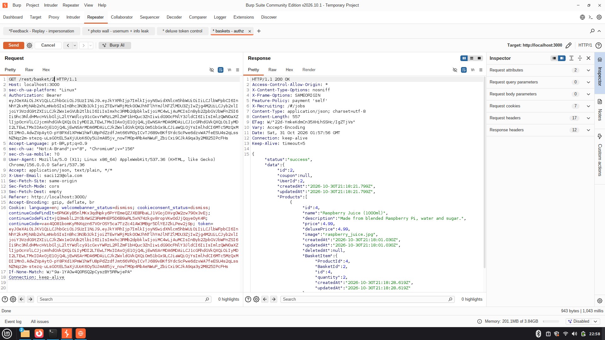

*Observação: o acesso de leitura não comprova automaticamente a possibilidade de alteração dos carrinhos de outros usuários.*

### 5.5. Itens do carrinho — validação de quantidade negativa

**Endpoint:** `/api/BasketItems`

Durante a análise da API responsável pelos itens do carrinho, foi investigado o comportamento do sistema diante de valores numéricos inválidos para a quantidade de produtos.

Foi observado que a API aceitou o envio de uma quantidade negativa, indicando possível ausência de validação adequada das regras de negócio.

Em uma operação de compra, a quantidade de um produto deve respeitar limites coerentes com a funcionalidade. A aceitação de valores negativos pode comprometer os cálculos e a consistência dos dados do carrinho.

Entretanto, a aceitação do valor negativo não comprova, por si só, que o sistema permite concluir uma compra com total negativo ou gerar algum benefício financeiro indevido.

**Possível vulnerabilidade:** falha de validação de regras de negócio.

**Impacto potencial:** manipulação de quantidades e comprometimento da integridade dos valores e operações do carrinho.

**Recomendação:** implementar validações no servidor para impedir quantidades negativas, valores inválidos e operações incompatíveis com as regras de negócio.

**Evidência 13 — Teste de quantidade negativa**

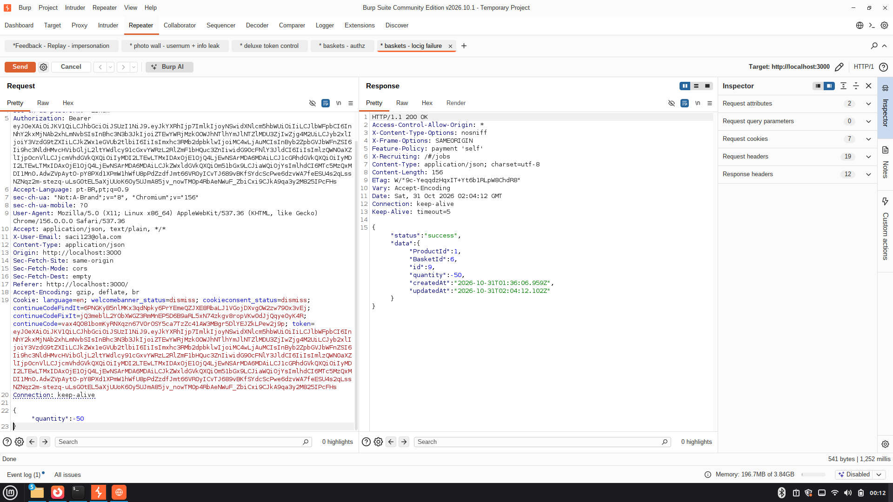


### 5.6. Análise e decodificação de token JWT

Durante a análise das requisições de autenticação, foi identificado um token utilizado pela aplicação.

O token foi copiado e analisado por meio de um decodificador JWT, permitindo visualizar seu conteúdo e obter informações armazenadas no payload.

A análise permitiu compreender melhor como a aplicação utiliza tokens para transportar informações relacionadas à autenticação e à identificação do usuário.

Foi possível observar que o conteúdo do token pode ser decodificado, pois utiliza codificação Base64URL. Isso não significa que o token foi descriptografado: a decodificação apenas permite visualizar os dados presentes no payload.

**Evidências:**

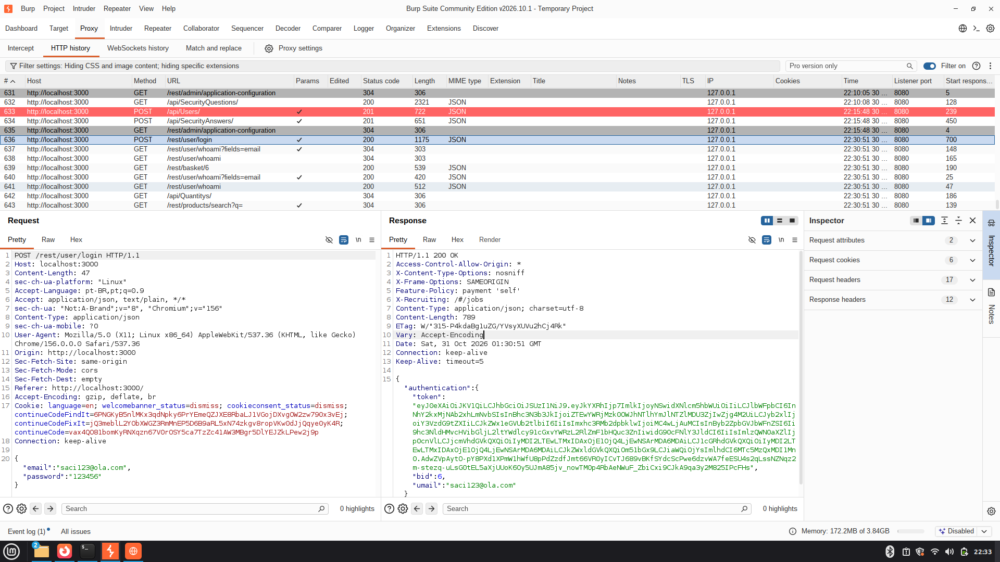

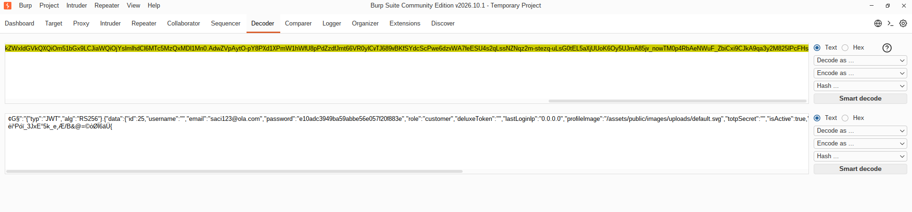


**Observação:** a visualização do conteúdo do token não comprova, por si só, uma falha de segurança. É necessário avaliar quais informações são armazenadas e se existem dados sensíveis ou permissões que não deveriam estar disponíveis ao cliente.


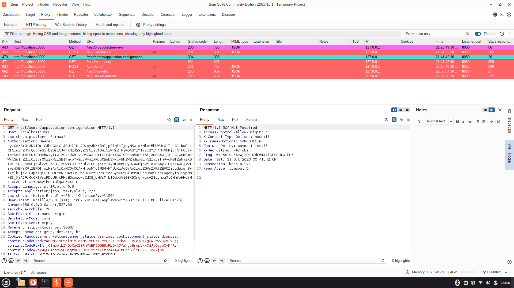


## 6. Identificação do e-mail da conta administradora

Durante o reconhecimento da aplicação, foi estabelecido como objetivo identificar informações relacionadas à conta administrativa do OWASP Juice Shop.

Para isso, foram consideradas duas fontes de investigação:

- Respostas do endpoint `/rest/products/{id}/reviews`, responsável por disponibilizar avaliações de produtos.
- Respostas do endpoint `/api/Feedbacks`, responsável por retornar registros de feedbacks.

A análise dessas respostas permite investigar os campos relacionados aos autores das avaliações e aos usuários associados aos feedbacks.

O procedimento de identificação consiste em:

1. Localizar a requisição correspondente no HTTP History do Burp Suite.
2. Inspecionar a resposta JSON.
3. Identificar os campos relacionados ao autor e ao usuário associado ao registro.
4. Verificar o e-mail retornado.
5. Confirmar, por uma evidência independente, se o usuário identificado corresponde à conta administrativa.


**Evidência 14 — Identificação do e-mail administrativo**

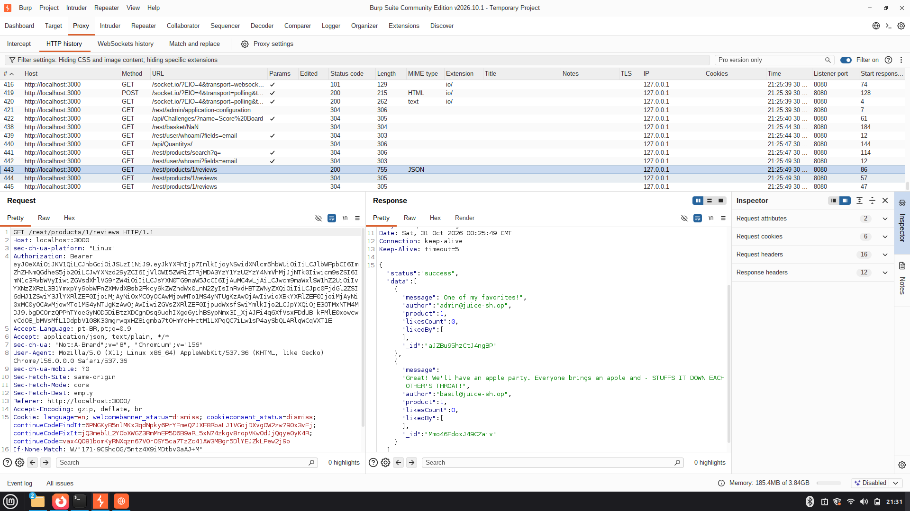

A identificação do e-mail não comprova, isoladamente, uma falha de autenticação ou acesso à conta. Seu valor nesta etapa está no reconhecimento de informações relacionadas a um usuário privilegiado.

## 7. Conclusão

A atividade permitiu conhecer melhor a estrutura do OWASP Juice Shop e praticar técnicas de reconhecimento e análise de segurança.

Durante os testes, foram identificadas rotas, arquivos públicos e comportamentos que podem representar riscos. Um dos principais resultados foi verificar que a aplicação aceitava e armazenava um campo adicional enviado durante o cadastro, indicando uma possível falha de Mass Assignment(OWASP).

Nem todos os comportamentos observados foram confirmados como vulnerabilidades, sendo necessários testes adicionais para comprovar seus impactos.

A experiência ajudou a desenvolver habilidades práticas na análise de aplicações web e na identificação de possíveis falhas de segurança.

## 8. Recomendações gerais

Com base nos comportamentos investigados, são recomendadas as seguintes medidas:

- Implementar controles de autenticação e autorização no servidor para todas as funcionalidades administrativas.
- Não confiar em identificadores de usuários enviados diretamente pelo cliente para definir autoria ou propriedade de recursos.
- Validar a propriedade de carrinhos e demais objetos antes de permitir consultas ou modificações.
- Restringir os campos aceitos pelas APIs por meio de listas de permissões.
- Impedir que atributos sensíveis, como `deluxeToken`, sejam definidos livremente durante o cadastro.
- Validar valores numéricos e regras de negócio no backend, impedindo quantidades negativas.
- Revisar os dados retornados pelas APIs para evitar a exposição desnecessária de informações pessoais.
- Revisar os arquivos e diretórios disponibilizados publicamente, garantindo que conteúdos sensíveis não sejam acessíveis sem autorização.
- Evitar utilizar o `robots.txt` como mecanismo de proteção de recursos, pois ele não substitui controles de acesso.

---

## 9. Organização das evidências

As capturas de tela utilizadas para comprovar os procedimentos e resultados estão organizadas no diretório `evidencias/`, com nomes relacionados às respectivas etapas do relatório.
